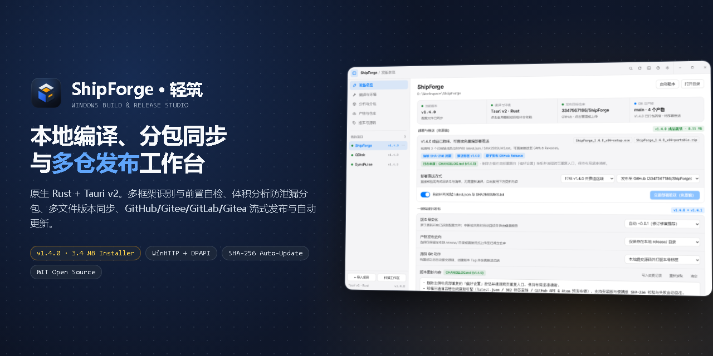
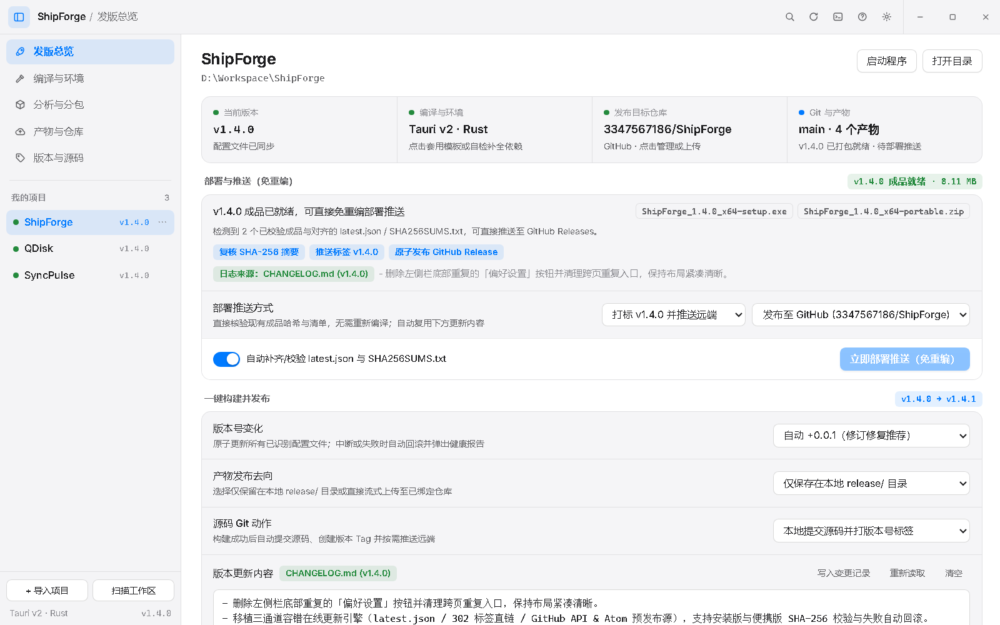
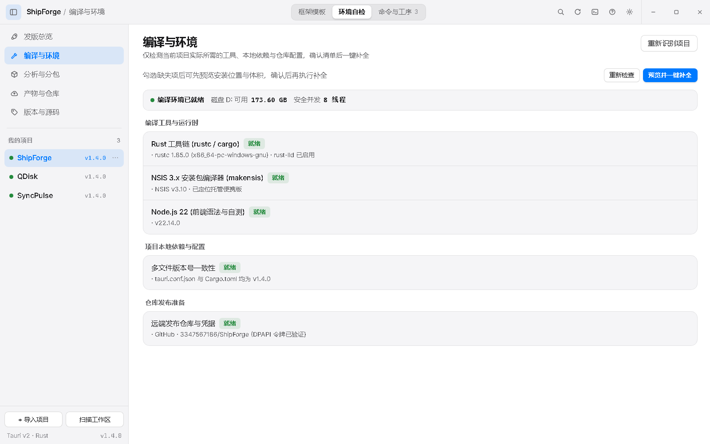
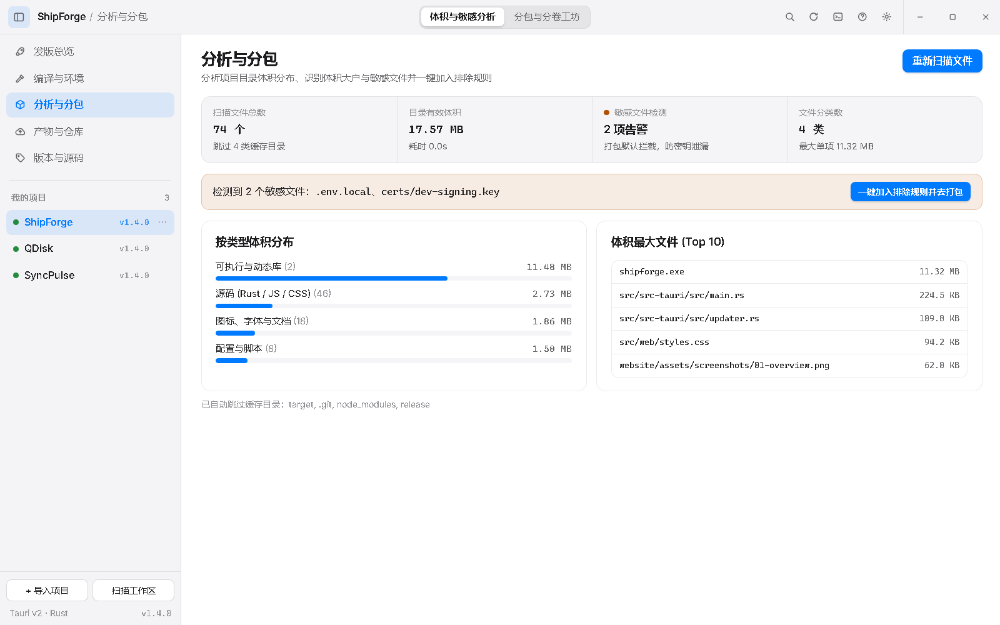
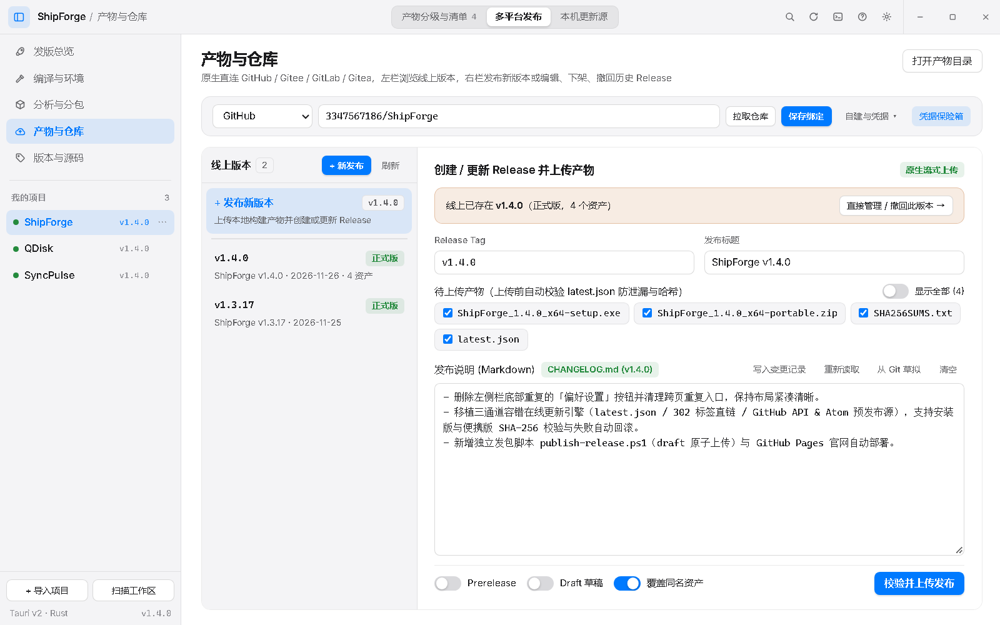
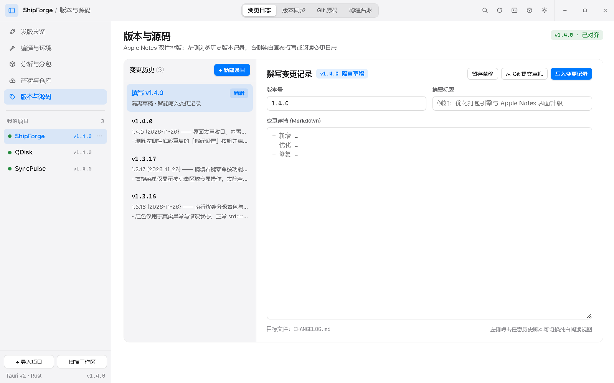
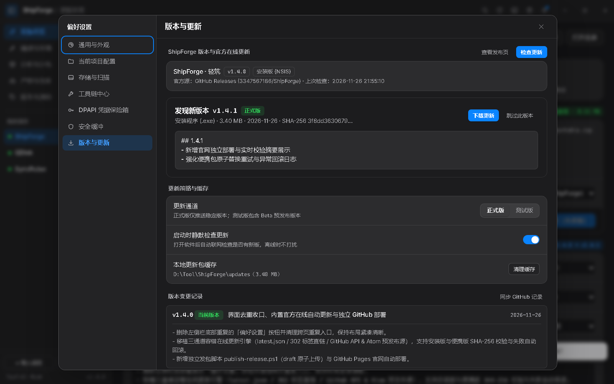

<div align="center">


# ShipForge

A local Windows desktop studio for multi-framework builds, split packaging, atomic version sync, and multi-platform release publishing. Built with Tauri v2 and native Rust, MIT licensed, with built-in auto-updates.

[](https://3347567186.github.io/ShipForge/?lang=en)
[](https://github.com/3347567186/ShipForge/releases/latest)
[](LICENSE)
[](#download--install)

[简体中文](README.md) | **English**

<br />

<a href="https://3347567186.github.io/ShipForge/?lang=en">
  
</a>

</div>

---

## Features

Browse interactive tabs and zoomable screenshots on the [website](https://3347567186.github.io/ShipForge/?lang=en), or review the core modules below.

### 1. Release Overview & No-Rebuild Deployment

The overview consolidates version sync status, detected build presets, bound repositories, and workspace changes. When artifacts for the current version are already built externally, ShipForge detects them and surfaces a dedicated deploy card so you can push without rebuilding.

If a mutating pipeline fails or is cancelled midway, unverified version edits and local Git commits roll back automatically while verified build artifacts stay protected.



### 2. Multi-Framework Detection & Scoped Prerequisite Checks

Automatically detects Rust, Node/TS, Python, Go, C#/.NET, Dart/Flutter, C/C++ (CMake), and Java (Maven/Gradle), alongside shells including Tauri, Electron, Wails, PyInstaller, NSIS, and Inno Setup.

Prerequisite inspection checks only the toolchains, local dependencies, and repository setup needed by the active project, presenting a transparent change plan before installing anything.



### 3. Directory Size Analysis, Secret Guards & Split Packaging

Inspect folder footprints and top large files before packaging. `.env`, private keys, certificates, and `.git` directories are blocked by default. Supports saved packaging profiles and multi-volume ZIP archives for platform size limits (e.g., 95 MB on Gitee) with SHA-256 manifests.



### 4. Multi-Platform Publishing, Split Changelog & Built-In Auto-Updater

| Multi-Platform Release Manager (GitHub / Gitee / GitLab / Gitea) | Split-Pane Changelog & Atomic Version Sync |
|---|---|
|  |  |

- **Direct streaming uploads**: Uses native Windows WinHTTP with progress tracking and Windows DPAPI-encrypted access tokens. Supports editing published releases, toggling drafts, recalling releases, and deleting individual assets.
- **Atomic version sync**: Keeps `tauri.conf.json`, `Cargo.toml`, `package.json`, `pyproject.toml`, `*.csproj`, `pubspec.yaml`, and custom regex targets aligned, with per-version draft isolation.
- **Built-in auto-updater**: Checks official GitHub Releases via 3-tier resilient fallback (`latest.json`, 302 tag redirect, and GitHub API / Atom prerelease feed), verifies SHA-256 and PE/ZIP headers, and rolls back automatically if a portable swap fails.



---

## Download & Install

Requires **Windows 10 / 11 (x64)**.

- **Website**: https://3347567186.github.io/ShipForge/?lang=en
- **Installer (~3.4 MB)**: Download `ShipForge_*_x64-setup.exe` from [GitHub Releases](https://github.com/3347567186/ShipForge/releases/latest)
- **Portable ZIP (~4.7 MB)**: Download `ShipForge_*_x64-portable.zip`, extract, and launch `shipforge.exe`
- **Checksums & updates**: Every release includes `SHA256SUMS.txt` and `latest.json`. Open `Preferences -> 版本与更新` inside the app to check, download, and install updates.

Configuration, managed tools, and update caches can be migrated off `C:` with SHA-256 verification from `Preferences -> 存储与扫描`.

---

## Metrics & Local Build

<details>
<summary>Measured Metrics & Framework Support</summary>

| Metric | Measured Result | Notes |
|---|---|---|
| Package footprint (v1.4.0) | App exe `11.32 MB` · Installer `3.40 MB` · Portable `4.71 MB` | Tauri v2 + native Rust, zero external CLI runtime |
| Automated test gate | `112` Rust tests + `21/21` frontend contract tests, `0` Release warnings | Parallel test gate ~`21.4 s` |
| Full release build | Incremental `~10–40 s` · Full build + NSIS + ZIP `~1m12s` | `rust-lld` + parallel codegen-units + parallel SHA-256 |
| Multi-project isolation | Tasks, logs, progress, version buckets & workspaces isolated per project | Includes non-Git file fingerprint watcher |
| Languages & shells | 8 languages × 8 packaging shells | Rust, Node, Python, Go, .NET, Flutter, C++, Java |

</details>

<details>
<summary>Stack, Local Build & Publish Commands</summary>

#### Stack

- **Shell & native modules**: Tauri v2 + Rust (`updater.rs`, `repo_client.rs` WinHTTP publisher, `credentials.rs` DPAPI vault, `packager.rs`, `transaction.rs`, `preflight.rs`)
- **Frontend**: Plain HTML / CSS / ES Modules (no bundler or `node_modules`)
- **Third-party crates & fonts**: See [THIRD_PARTY.md](THIRD_PARTY.md)

#### Build & Publish Locally

Requirements: Windows x64, Rust 1.80+, Node.js 20+, PowerShell 7 (`pwsh`), NSIS 3.x.

```powershell
git clone https://github.com/3347567186/ShipForge.git
cd ShipForge

# 1. Run Rust, frontend, and website test gate
pwsh -NoProfile -ExecutionPolicy Bypass -File .\build.ps1 -TestsOnly

# 2. Bump version and build NSIS installer, portable ZIP, SHA256SUMS.txt & latest.json
pwsh -NoProfile -ExecutionPolicy Bypass -File .\build.ps1 -Bump patch

# 3. Publish atomically to GitHub Releases (requires gh auth login)
pwsh -NoProfile -ExecutionPolicy Bypass -File .\tools\publish-release.ps1 -UploadGitHub

# 4. Run a local 127.0.0.1 loopback update feed
pwsh -NoProfile -ExecutionPolicy Bypass -File .\tools\publish-release.ps1 -ServeLocal -Port 18765
```

</details>

---

Licensed under [MIT](LICENSE). Issues and PRs are welcome at [GitHub Issues](https://github.com/3347567186/ShipForge/issues).

---

## Support

ShipForge is free, open-source, and ad-free. If it saves you time when building and releasing software, feel free to buy me a coffee or leave a Star.

<div align="center">
  <table>
    <tr>
      <td align="center" width="240">
        <br />
        <sub>WeChat Pay</sub>
      </td>
      <td align="center" width="240">
        <br />
        <sub>Alipay</sub>
      </td>
    </tr>
  </table>
</div>
