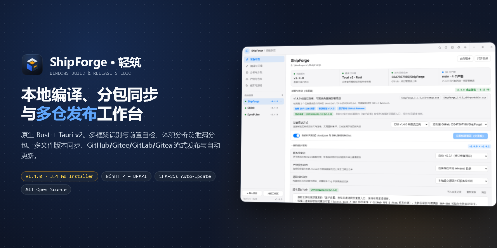
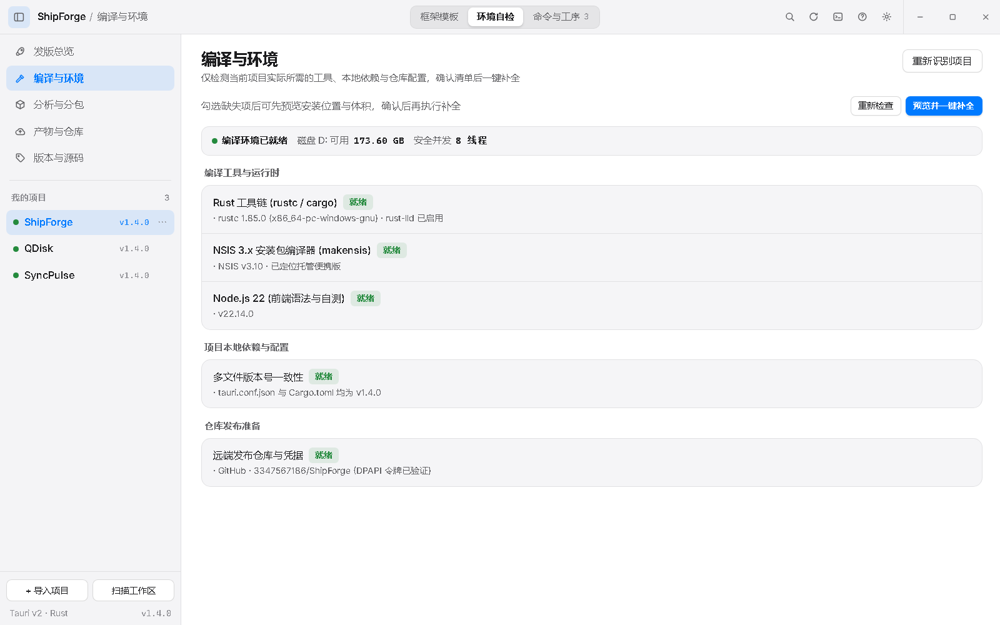
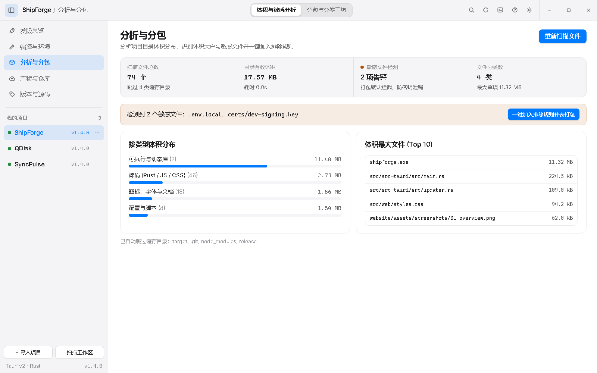
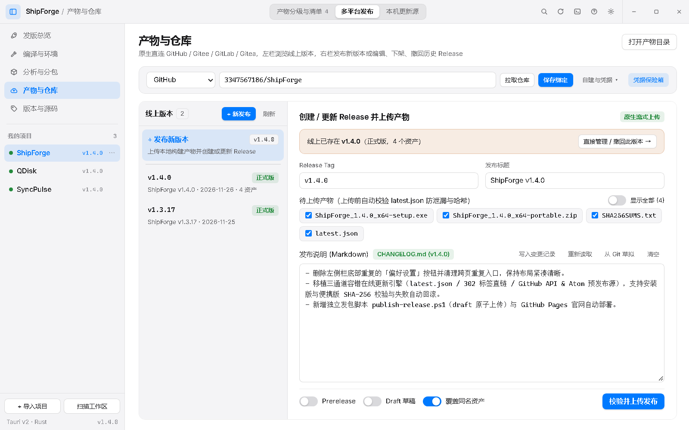

<div align="center">


# ShipForge · 轻筑

Windows 本地多框架构建、体积分析分包、多文件版本同步与多平台发布桌面工作台。基于 Tauri v2 + 原生 Rust 构建，MIT 开源，内置官方在线自动更新。

[](https://3347567186.github.io/ShipForge/)
[](https://github.com/3347567186/ShipForge/releases/latest)
[](LICENSE)
[](#下载与安装)

**简体中文** | [English](README.en.md)

<br />

<a href="https://3347567186.github.io/ShipForge/">
  
</a>

</div>

---

## 主要功能

完整交互演示与高清大图浏览可访问 [官网](https://3347567186.github.io/ShipForge/)，下面是核心工作区的实际界面。

### 1. 发版总览与免重编独立部署

导入本地项目后，总览页集中呈现版本号对齐状态、构建框架、绑定仓库与工作区变动。支持一键递增版本、读取或回写变更日志、执行构建测试与发布；若本地已通过命令行打包出当前版本成品，会自动识别并弹出「免重编部署与推送」卡片直接补传。

任意变更性流水线中途取消或失败时，未验证的本地版本号与提交自动回滚，已通过验收的成品则安全保留，避免重复编译。


### 2. 多框架识别与三层项目级前置自检

自动识别 Rust、Node/TS、Python、Go、C#/.NET、Dart/Flutter、C/C++ (CMake)、Java (Maven/Gradle) 以及 Tauri、Electron、Wails、PyInstaller、NSIS、Inno Setup 等外壳与混合项目。

前置环境自检仅核对当前项目真实需要的编译器、本地依赖与仓库配置，展示清晰变更清单并在确认后执行补全。



### 3. 目录体积分析、敏感拦截与分卷工坊

打包前可先分析项目目录体积分布与大文件排行，默认拦截 `.env`、私钥、证书与 `.git` 目录防止误打入公开包。支持多套自定义分包预设，以及适配平台单文件上限（如 95 MB）的原生分卷压缩与校验清单生成。



### 4. 多平台仓库直连、双栏变更日志与内置自动更新

| 多平台直连发布（GitHub / Gitee / GitLab / Gitea） | 双栏变更日志与多文件版本原子同步 |
|---|---|
|  |  |

- **原生多仓发布**：基于 Windows WinHTTP 流式上传并带进度显示，访问令牌经 Windows DPAPI 系统加密保存（零明文落盘），支持编辑线上发布、切换草稿、下架撤回与删除单个附件。
- **多文件版本同步**：原子同步 `tauri.conf.json`、`Cargo.toml`、`package.json`、`pyproject.toml`、`*.csproj`、`pubspec.yaml` 或自定义正则文件，并支持按版本号隔离草稿。
- **内置官方在线更新**：偏好设置「版本与更新」内置三通道容错更新（`latest.json` → 302 标签直链 → GitHub API / 零限流 Atom 预发布源），强制校验 SHA-256 与文件头，便携版更新失败自动回滚。


---

## 下载与安装

支持 **Windows 10 / 11 (x64)**。

- **官网**：https://3347567186.github.io/ShipForge/
- **安装版（约 3.4 MB）**：在 [GitHub Releases](https://github.com/3347567186/ShipForge/releases/latest) 下载 `ShipForge_*_x64-setup.exe`
- **便携版（约 4.7 MB）**：在同一页面下载 `ShipForge_*_x64-portable.zip`，解压后直接运行 `shipforge.exe`
- **校验与更新**：每次发布附带 `SHA256SUMS.txt` 与 `latest.json`。可在软件「偏好设置 → 版本与更新」一键检查、下载并完成升级。

配置文件、托管工具与更新缓存默认保存在本地数据目录，支持在「偏好设置 → 存储与扫描」中带 SHA-256 校验一键迁移至其他盘符。

---

## 实测数据与本地构建

<details>
<summary>实测指标与支持矩阵</summary>

| 指标项 | 实测结果 | 说明 |
|---|---|---|
| 产物大小（v1.4.0） | 主程序 `11.32 MB` · 安装包 `3.40 MB` · 便携包 `4.71 MB` | Tauri v2 + 原生 Rust，零外部 CLI 依赖 |
| 全量测试门禁 | `112` 项 Rust 单测 + `21/21` 前端契约自测，Release `0` 警告 | 并发测试门禁约 `21.4 s` |
| 发布构建耗时 | 增量编译 `~10–40 s` · 全量含 NSIS + ZIP 打包 `~1m12s` | `rust-lld` + 并行 codegen-units + 多核 SHA-256 |
| 多项目隔离 | 按 `projectId` 隔离任务、日志、进度、版本桶与工作区 | 内置非 Git 文件指纹扫描与外部构建锁监控 |
| 语言与外壳支持 | 8 主流语言 × 8 打包外壳 | Rust / Node / Python / Go / .NET / Flutter / C++ / Java |

</details>

<details>
<summary>技术栈、本地编译与推送更新命令</summary>

#### 技术构成

- **主程序与原生模块**：Tauri v2 + Rust（`updater.rs` 在线更新、`repo_client.rs` WinHTTP 多仓流式发布、`credentials.rs` DPAPI 令牌库、`packager.rs` 分包校验、`transaction.rs` 事务回滚、`preflight.rs` 前置自检）
- **界面**：原生 HTML / CSS / ES Module，无前端构建打包器与 `node_modules`
- **第三方组件**：详见 [THIRD_PARTY.md](THIRD_PARTY.md)

#### 本地开发、构建与推送更新

环境要求：Windows x64、Rust 1.80+、Node.js 20+、PowerShell 7 (`pwsh`)、NSIS 3.x。

```powershell
git clone https://github.com/3347567186/ShipForge.git
cd ShipForge

# 1. 运行 Rust + 前端 + 官网全量测试门禁
pwsh -NoProfile -ExecutionPolicy Bypass -File .\build.ps1 -TestsOnly

# 2. 递增版本并打包 NSIS 安装包、便携 ZIP、SHA256SUMS.txt 与 latest.json
pwsh -NoProfile -ExecutionPolicy Bypass -File .\build.ps1 -Bump patch

# 3. 原子推送到 GitHub Releases（需先 gh auth login）
pwsh -NoProfile -ExecutionPolicy Bypass -File .\tools\publish-release.ps1 -UploadGitHub

# 4. 启动本地 127.0.0.1 回环测试更新源
pwsh -NoProfile -ExecutionPolicy Bypass -File .\tools\publish-release.ps1 -ServeLocal -Port 18765
```

详细发包与更新验证步骤见 [发包与在线更新指南](docs/发包与在线更新指南.md)。

</details>

---

本项目基于 [MIT License](LICENSE) 开源。欢迎提交 [Issue](https://github.com/3347567186/ShipForge/issues) 或 Pull Request。

---

## 赞赏支持

软件免费开源且无广告。如果它平时帮你省下了打包发版时间，可以随心请作者喝杯咖啡，或在右上角点个 Star。

<div align="center">
  <table>
    <tr>
      <td align="center" width="240">
        <br />
        <sub>微信支付</sub>
      </td>
      <td align="center" width="240">
        <br />
        <sub>支付宝</sub>
      </td>
    </tr>
  </table>
</div>
